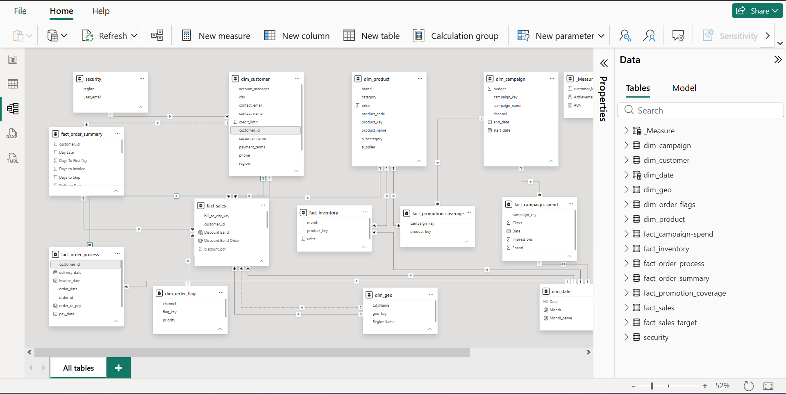
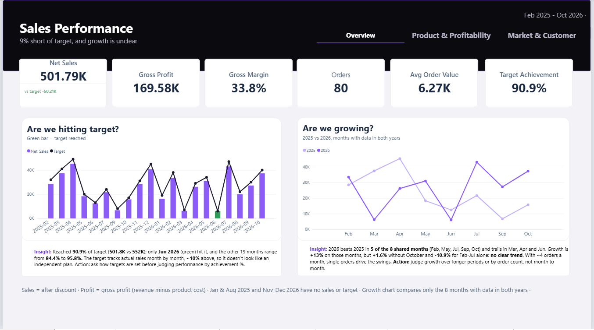

# Sales Performance Analysis | Power BI Dashboard

> **Executive summary:** Analyzed the sales of a fictional B2B distributor (**Feb 2025 - Oct 2026**: **501.8K net sales, 169.6K gross profit, 33.8% margin, 80 orders**) and built a 3-page Power BI dashboard. Key findings: sales reached only **90.9% of target**, growth is **unclear** (+13% to -11% depending on the months compared), and **discounts cost 14.7% of profit** with no sign of lifting volume.

---

## 1. Business Problem

A B2B distributor sells to business customers through 4 channels in 5 regions. Sales management wants to know:

- Are we hitting target, and are we growing?
- Do discounts help or only reduce margin?
- Who buys, from where, and through which channel?

## 2. Dataset & Data Model

- **Source:** practice dataset `project_data_model.xlsx` (synthetic) <!-- TODO: add the dataset link -->
- **Scope:** 200 order lines, 80 orders, 60 products, 47 active customers (of 60), Feb 2025 - Oct 2026.
- **Model:** star schema: `fact_sales` linked to product, customer, channel, geography and date tables, plus a monthly target table. `dim_date` is a DAX calendar; `dim_geo` is used twice (ship-to active, bill-to inactive).

<p align="center">
  
</p>

**Data quality issues and what I did**

| Issue | Impact | Action |
|---|---|---|
| `line_total` ignores the discount | 526.6K vs the real 501.8K | Calculated net sales myself |
| `"Online Store "` had a trailing space | A merge returned nulls (139.8K under a blank channel) | Trimmed it in Power Query |
| 3 order lines have no product | 0.1% of sales | Kept in totals, excluded from category views |
| No data in Jan/Aug 2025 and Nov-Dec 2026 | Empty months distort charts | Hid them; compared years on shared months only |

## 3. Tools & Skills

Power BI · Power Query · Data Modeling · DAX · Custom Theme (JSON) · Dashboard Design · Business Storytelling
<!-- TODO: keep only what you really used -->

## 4. Dashboard

**Page 1: Overview** - KPIs, net sales vs target by month, 2025 vs 2026 on shared months.
<p align="center"></p>

**Page 2: Product & Profitability** - discount impact on margin and quantity, margin by category, top products by units.
<p align="center"></p>

**Page 3: Market & Customer** - top customers, regions, channels, segments.
<p align="center"></p>

## 5. Key Calculations

```DAX
Net_Sales           = SUMX(fact_sales, fact_sales[quantity] * fact_sales[unit_price] * (1 - fact_sales[discount_pct]))
Profit              = [Net_Sales] - [Total_cost]
Margin %            = DIVIDE([Profit], [Net_Sales])
Discount Amount     = [Gross_Sales] - [Net_Sales]
Discount % of Gross = DIVIDE([Discount Amount], [Gross_Sales])
Achievement %       = DIVIDE([Net_Sales], [target])
```
<!-- TODO: make sure these match your final measures -->

## 6. What I Found (Insights)

**1. Sales reached 90.9% of target (501.8K vs 552K).** Only June 2026 hit it. The monthly target tracks actual sales (about 10% above), so it does not look like an independent plan.
*My recommendation:* ask how targets are set before judging performance by achievement %.

**2. Growth is unclear.** +13% on the 8 shared months, +1.6% without October, -10.9% for February to July. With about 4 orders a month, single orders drive the swings.
*My recommendation:* judge growth over longer periods, not month to month.

**3. Discounts cost 14.7% of profit and show no sign of lifting volume.** Margin falls from 37.5% (no discount) to 26.2% (15%) in every category, while average quantity per line does not rise (5.6 vs 4.9).
*My recommendation:* cap discounts near 5% or tie them to a minimum quantity.

**4. The channels that discount most earn least.** Field Sale (6.5% discounts, 32.2% margin) and Retail Partner (6.4%, 33.2%) vs Online Store (3.0%, 34.9%).
*My recommendation:* review discount approval in Field Sale and Retail Partner.

**5. No customer dominates, but about half of active customers bought once.** The largest customer is 6.3% of sales, the top 10 are 44.8%, and 24 of 47 active customers placed one order.
*My recommendation:* build a repeat-purchase plan for one-time buyers.

**Other observations:** the top 5 products by units are only 16.7% of sales (24.2% by revenue). Margins vary little by region (31.7% to 34.9%), segment (33.5% to 34.0%) and category (31.0% to 36.2%), so I did not build recommendations on them.

## 7. Limitations & Assumptions

- Practice project on a small synthetic dataset (80 orders, about 4 per month): conclusions are directional and recommendations illustrative.
- Profit is **gross profit** (net sales minus product cost), without shipping, payroll or marketing. Net sales are after discount.
- Jan/Aug 2025 and Nov-Dec 2026 have no data; growth uses only shared months. October 2026 includes 2 orders (13.6K) dated after 13 October.
- The discount analysis shows an association, not a cause; the reasons for discounts are unknown.
- 3 order lines (0.1%) without a product are excluded from category views. Region is the customer's region.
